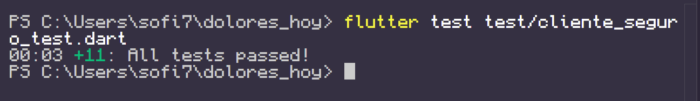
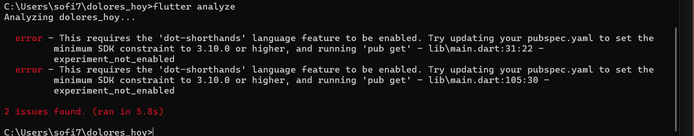
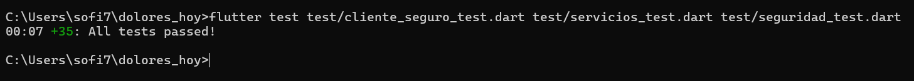
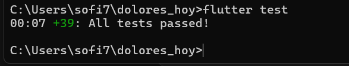
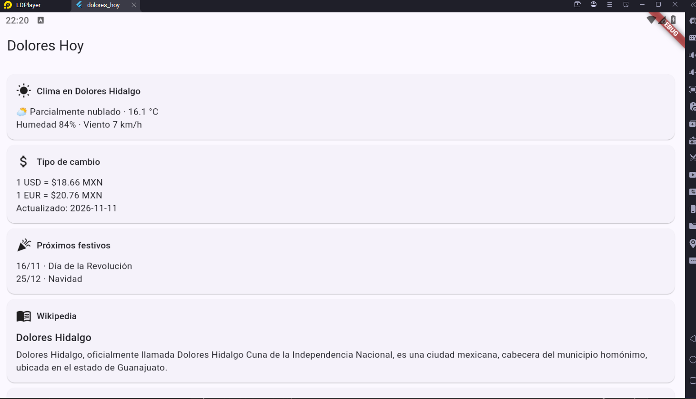
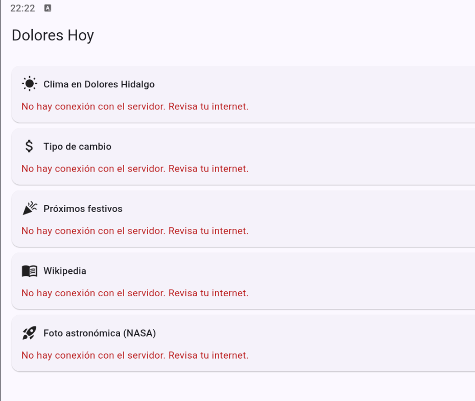
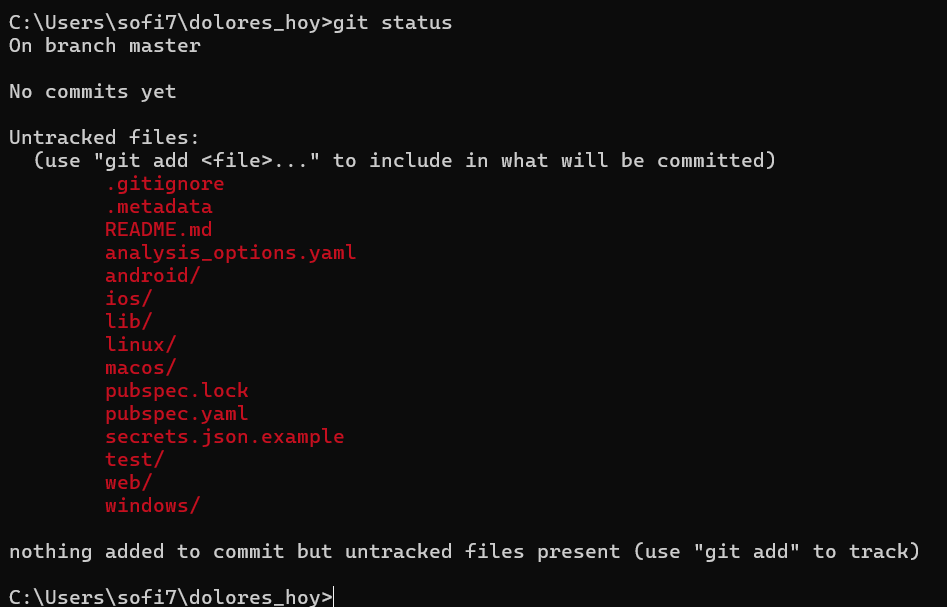
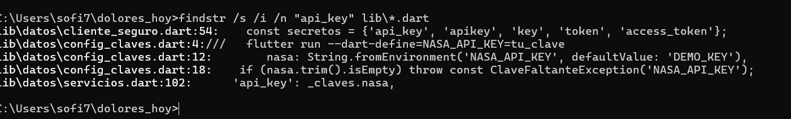
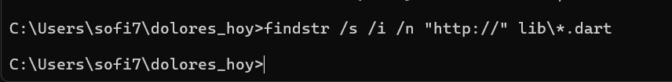
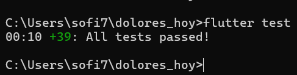

# Dolores Hoy

Tablero en Flutter que consume **5 APIs gratuitas** aplicando buenas prácticas de seguridad.
Desarrollo Móvil Integral · UTNG

**Alumna:** [Tu nombre completo]
**Grupo:** [Tu grupo]
**Profesor:** Anastacio Rodríguez García

## APIs utilizadas

| # | API | Dato | Clave |
|---|-----|------|-------|
| 1 | Open-Meteo | Clima actual de Dolores Hidalgo | No |
| 2 | Frankfurter | Tipo de cambio peso-dólar-euro | No |
| 3 | Nager.Date | Próximos días festivos de México | No |
| 4 | Wikipedia (es) | Resumen de Dolores Hidalgo | No |
| 5 | NASA APOD | Foto astronómica del día | Sí |

## Pruebas

    flutter test

## Evidencias

### Proceso y Funcionamiento 

